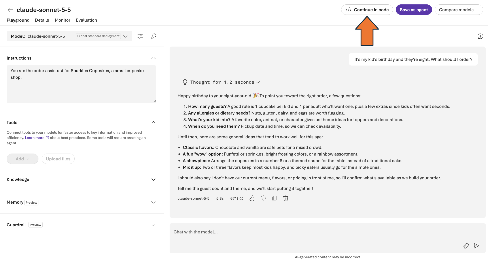

## Module 1.0: Meet your model (10 minutes)

We'll start in the Foundry Playground, without code. You'll give Claude a role
with a system prompt, then see what it can't answer without your shop's real
information. The rest of this lab works to add information to our agent.

### Sign in
1. Sign in to the virtual machine with the following credentials:
   
   **Username**: `@lab.VirtualMachine(Windows11).Username`  
   **Password**: `@lab.VirtualMachine(Windows11).Password`

1. Open **Microsoft Edge** from the Windows taskbar.
2. Go to `https://ai.azure.com` and sign in with the workshop account:

	**Username**: `@lab.CloudPortalCredential(User1).Username`  
	**Access Pass**: `@lab.CloudPortalCredential(User1).AccessToken`
   
	>[!note]The sign-in details are also on the Resources tab.
4. If the top bar has a **New Foundry** toggle, make sure it's turned on.
5. From the project listings on the main page, select the pre-created
   project. There should only be one.
6. If a dialog pops up, select the close or **Skip** button.


### Find the Claude deployment

1. In the left navigation choose **Build**, then **Models**.
2. Open the **Deployments** tab. You'll see a Claude Sonnet deployment
   (the name matches 'FOUNDRY_MODEL_DEPLOYMENT' in your '.env') and a Claude
   Haiku deployment. Those are the two this lab uses. Your project may list
   other Claude models as well.


> **Model vs. deployment.** A model is what Anthropic ships. A deployment is
> your project's copy of it with a name, an endpoint, and quota. Your code
> always talks to the deployment name.

### Give it a role

Click the Sonnet deployment, then **Open in playground**. Find the
**Instructions** panel (the system prompt) and paste:

```
You are the order assistant for Sparkles Cupcakes, a small cupcake shop.
```

Then, in the chat box, ask: 'It's my kid's birthday and they're eight.
What should I order?'

One sentence, and you have a shop assistant. No examples, no formatting rules,
no 'be polite'. In the code you write next, the same field is called
'instructions'.

### Find the edge

Read the reply. You'll probably get general ideas, like vanilla or chocolate
with bright frosting, or some questions about the party. Notice what's missing:
it can't tell you what Sparkles actually sells.

You told it that it works at a cupcake shop. You didn't tell it what the shop
sells.

Now ask: 'What's your refund policy?'

It will most likely tell you it doesn't have that information, and suggest you
check with the shop. That's the behavior you want: it doesn't make up a policy.
But it's not much use to your customer yet, and your assistant can't do its job
with what it knows so far.

Models don't all behave the same way here, so check how yours handles questions
it can't answer. Never assume an answer is grounded unless you gave it the facts.

Module 1.2 gives it the real menu. Module 1.3 gives it the real policies.

### Look at the code

Click the **Continue in code** button. This is the same call you'll make from Python in the
next module. Note the three things it needs: the endpoint, a key, and the
deployment name.



✅ **Checkpoint 1.** You have talked to Claude on Foundry, and seen what it does
and doesn't know about your shop.
