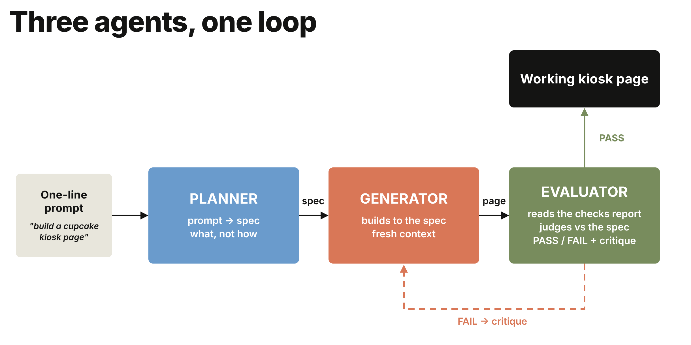

## Module 2.1: The agent that checks its own work (20 minutes)

An agent that runs for a minute needs a good
prompt. An agent that runs for an hour needs something to check the work and
decide whether it's done or needs another try.

The loop has four steps: write down what "done" looks like, build, check the
result against it, and send back what failed. It repeats until the result
passes or the rounds run out. The rest of this lab builds on this loop.



One line of intent goes in on the left. The planner turns it into a spec, the
generator builds to it, and the evaluator answers PASS or FAIL with a critique.
FAIL starts another round. PASS ends the loop.

Three scripts, three roles, two Claude deployments:

- **planner.py**: one line of intent in, a testable spec out. Sonnet.
- **generator.py**: spec in, a single-file kiosk page out. Haiku, the faster
  tier. It writes the most tokens by far, and it's working from a
  spec rather than judging anything.
- **evaluator.py**: the spec plus hard evidence in, PASS or FAIL out, with a
  critique. Sonnet, because the work is only ever as good as the judge.

In this module you'll run each one on its own first, so you see what it
produces, and then run the whole loop.

Your terminal is in 'sparkles-agent' from Lab 1. Go up one folder and into
'sparkles-loop':

```
cd ../sparkles-loop
```

That line works in PowerShell and in bash. If you opened a new terminal
(**Terminal > New Terminal** in VS Code) and it's in the 'anthropic' folder,
use 'cd sparkles-loop'.

### Step A: the planner (5 minutes)

**Open 'planner.py' before you run it.** Its job is to turn a request into a
list of things that can be checked without a person looking.

- **'PROMPT'** is the request: a kiosk page with today's flavors that customers
  can tap to select, a special, and a running order count. Clear to a human, but there's nothing in it a
  script could test.
- **'SPEC_SCHEMA'** makes the answer come back as fixed JSON rather than prose.
- **'SYSTEM'** tells Claude every acceptance criterion has to name a
  'data-testid' on the page. Those are the names the evaluator looks for
  later.

```
python planner.py
```

Read the spec it prints: three or four features, each with an acceptance
criterion, saved to 'workspace/spec.json'.

Each criterion names a part of the page by its 'data-testid'. That's a label
in the HTML that lets a script find the part, however the page looks.
The spec always covers these five:

| 'data-testid' | The element | What has to be true |
|---|---|---|
| 'title' | the shop name at the top | it's there |
| 'flavor-list' | today's flavors | it's there, and holds at least three flavors, each its own element |
| 'special' | the special of the day | it's there |
| 'order-btn' | the Place Order button | it's there |
| 'order-count' | the running count of orders | it's there |

Every step in this module uses this list. The generator is told to
use exactly these names, 'checks.py' counts them, and the evaluator passes or
fails the page on them. It's also the same list the code evaluator scores in
Module 2.4.

### Step B: the generator, with a planted bug (3 minutes)

The generator turns the spec into one HTML page for the shop counter.

**Open 'generator.py'.**

- **'SYSTEM'** is its entire brief: here's the spec, return one
  self-contained HTML file.
- It has no memory between sprints and never sees the evaluator's reasoning,
  only the critique text fed back in. That's what stops it grading its own
  work.
- **'seed()'** loads a first draft instead of generating one.

**The seed.** '--seed' loads 'seeds/kiosk_buggy.html', a page we wrote with two
mistakes in it. Open it in VS Code and find the two 'BUG' comments.

- **Only one flavor is listed.** The spec asks for three.
- **The order counter is missing.** The JavaScript tries to update an element
  called 'order-count' that was never added to the page. It checks the element
  exists first, so nothing breaks; the count just never appears.

**Why start broken?** A page we know is wrong fails the first round every
time, so there's always a loop to watch.

```
python generator.py --seed
```

That copies the page to 'workspace/index.html', which is what everything
downstream reads.

### Step C: evidence and the evaluator (4 minutes)

First a script measures the page, then Claude decides whether that's good
enough.

**Open 'checks.py'.** No Claude here. It's ordinary Python that opens
'workspace/index.html' and counts what's on the page.

- **'evidence()'** reports which 'data-testid' names it found and how many
  items are in each list.
- Run it twice and you get the same answer twice. Ask the generator whether it
  built the page correctly and you get an opinion; this gives you a count.

```
python checks.py
```

The report lists which test ids exist, how many items each list has, and
whether the page pulls in any external scripts. Compare it with the spec from
Step A: the flavor list should have three items and it has one.

**Open 'evaluator.py'.** This is Claude again, in a fresh session, and it gets
two things: the spec, and the report you just ran.

- It never sees the HTML, and never sees what the generator said about its own
  work. A reviewer who reads the author's explanation first tends to agree with
  it.
- **'VERDICT_SCHEMA'** makes it answer PASS or FAIL with a written critique, in
  a fixed shape the loop can act on.

```
python evaluator.py
```

It should FAIL on the flavor list and the missing order counter, and write a
critique saying exactly what to change. That critique is what the generator
gets handed in the next step.

### Step D: the whole loop (4 minutes)

**Open 'run_loop.py'.** It's short, because the three scripts you just ran
do the work. This one decides what happens next.

- **'MAX_SPRINTS'** stops it after three rounds. Without a limit, a page the
  evaluator never accepts would loop forever.

```
python run_loop.py
```

Sprint 1 loads the seeded draft and fails. Sprint 2 hands the critique to the
generator, which rewrites the page. The evaluator checks again and passes.

**Now look at what it built.** In the terminal, run this to open the page in
your browser:

```
Invoke-Item workspace\index.html
```


- A flavor list with every flavor on its own row, instead of the single one
  the seed had. You may see more than three; the spec sets a minimum, not a
  maximum
- The special of the day, called out on its own
- The order counter next to the button, showing 0
- Tap a flavor and it's highlighted. Click the order button and the count goes
  to 1. Until a flavor is selected, the button does nothing

Open the first draft alongside it to see where it started: one flavor, and no
counter at all.

```
Invoke-Item seeds\kiosk_buggy.html
```

**This page is a demo. It doesn't take real orders.** What matters is what the
loop showed: it built a page to a spec, caught its own mistake, and fixed it.

> Why this matters. When an agent writes more code than you can review, the
> review becomes the bottleneck. A separate judge with its own evidence helps
> more than a better prompt for the writer, so that's where the effort goes.

> Try it: run 'python run_loop.py --fresh' to let the generator build the
> first draft itself instead of using the seed.

### Step E: ground the plan in web search (4 minutes)

In Lab 1 the agent learned what the shop knows, from Foundry IQ. **Web search**,
built into Claude on Foundry, adds what's happening now. Use it when a plan
depends on information newer than the model's training.

**Open 'websearch.py'.** 'QUESTION' is what gets asked, and you can edit it.
Claude runs the searches and reads the results on the server side, so your
script never fetches a web page itself.

```
python websearch.py
```

Claude searches, reads a few results, and recommends a special with its
sources listed at the bottom. Compare with your neighbor and see whether you
got the same answer.

Now let the planner do the same before it writes the spec, inside the full
loop:

```
python run_loop.py --research
```

The research notes print first, then the spec. The flavors and the special
now come from live results, so your kiosk won't match your neighbor's. The
rest of the loop is unchanged: same generator, same checks, same judge.

✅ **Checkpoint 8.** A planted bug caught by a Claude evaluator and fixed by a
Claude generator, with a written verdict for every round, and a plan grounded
in live web search with its sources.
