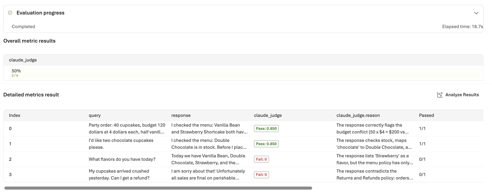

## Module 2.4: Evaluations, judged by Claude (20 minutes)

One good run doesn't tell you an agent is good. **Evaluations** score every run
and keep the history, so you can see whether a change helped. In Module 2.1 you
built a judge by hand, and in Module 2.2 your code checked the agent's work.
Foundry has a built-in version of both: you register an evaluator, point it at a
dataset of runs, and the portal scores every row. This module registers two
evaluators, one with no model at all and one where Claude is the judge, and
scores four real Sparkles runs.

> Foundry also ships built-in AI-assisted evaluators (relevance, task
> adherence, and so on), which come with their own judge model. We use custom
> evaluators here so that Claude is the judge, and so you see how to bring
> your own, which is what most teams end up doing.

### Setup

```
cd ../sparkles-evals
az login --use-device-code
```

The command prints a code and a web address. Open the address in Edge, enter
the code, and sign in with the same workshop account as in Module 1.0:

   **Username**: `@lab.CloudPortalCredential(User1).Username`  
   **Access Pass**: `@lab.CloudPortalCredential(User1).AccessToken`

Then come back to the terminal. If it asks you to select a subscription, press
Enter to keep the default.

Check '.env' has 'AZURE_AI_PROJECT_ENDPOINT' and 'EVAL_ENDPOINT_CONNECTION'
(your lab environment already has that connection). Your evaluators have your user
name in their names, so they don't collide with your neighbor's.

Look at 'sample_runs.jsonl'. Four rows, each one a saved Sparkles run with
four fields: what the customer asked, what the agent replied, a static report
of the kiosk page that run produced, and the receipt it printed.

**The two evaluators read different halves of each row.** The code-based one in
Step A only sees 'report' and 'receipt'. The Claude judge in Step B only sees
'query' and 'response'. Neither sees the other's evidence, which is why they
can disagree about the same run.

| Row | The conversation | The kiosk page | The receipt | Planted problem |
|---|---|---|---|---|
| 1 | Party order: 40 cupcakes, over budget, nut allergies, hazelnut. The agent catches the total, the budget, the allergy and the bulk-order rules | all five elements present | valid | nothing: this is what good looks like |
| 2 | Two chocolate cupcakes. The agent checks stock and flags the tree-nut policy before ordering | **the order counter is missing** | valid | a broken page |
| 3 | What flavors do you have today? The agent lists flavors, some of which the shop doesn't sell | **the special of the day is missing**, and the page loads a script from another site | **'not an order'**, so nothing to parse | a broken page and a wrong answer |
| 4 | Cupcakes arrived crushed, can I get a refund? The agent says all sales are final | all five elements present | valid | **the answer is wrong**: the shop's policy gives a refund for damaged orders |

### Step A: a code-based evaluator (10 minutes)

Open 'grade_sparkles.py'. It's a plain Python 'grade()' function: 60 percent of
the score for required test ids present in the kiosk report, 40 percent for a
receipt that parses and has every required key. No model is involved.

Two scripts: **'register_code_evaluator.py'** uploads 'grade_sparkles.py' to your
Foundry project, which you do once. **'run_cloud_eval.py code'** sends the rows
to the project and waits while Foundry scores them in the cloud. When it's done,
it prints each row's score and a report URL.

```
python register_code_evaluator.py
python run_cloud_eval.py code
```

The run prints a report URL. Open it in the portal.


**How the score is worked out.** 'grade_sparkles.py' gives each row a number
from 0 to 1, in two parts:

- **0.6 for the kiosk**, split across the five required test ids. Each one
  present is worth 0.12.
- **0.4 for the receipt**, all or nothing: it has to parse as JSON, carry every
  required key, and total more than zero.

**The threshold is separate from the score.** It's set to 0.9 in
'run_cloud_eval.py', and it decides where pass turns into fail. It changes no
scores; it only moves the line. At 0.9 a row has to have every test id *and* a
valid receipt, which is the same standard the loop in Module 2.1 enforced.

**What you should see:**

| Row | Score | Why | |
|---|---|---|---|
| 1 party order | 1.00 | all five elements on the page, receipt parses | pass |
| 2 chocolate | 0.88 | 'order-count' missing, costing 0.12. Receipt fine | **fail** |
| 3 flavors | 0.48 | 'special' missing, and 'not an order' won't parse, losing the whole 0.4 | **fail** |
| 4 refund | 1.00 | nothing structurally wrong | pass |

Two of four, so the report reads 50%.

The chocolate row is worth pausing on. It's missing the order counter, the
same fault the evaluator caught in Module 2.1, and it still scores 0.88. Set
the threshold at 0.5 and this kiosk ships. A weighted score makes one missing
element look like a rounding error.

And the refund row passes at 1.00 while telling the customer something false,
because the checks never read the answer.

### Step B: an endpoint-based evaluator, Claude as judge (10 minutes)

Some things can't be graded by rules. Did the agent tell the customer the
truth about the refund policy? No static check can answer that. For it you
need a model that has read the same policy document the agent should have.

Your lab environment comes with its own small service (see 'eval-endpoint/' in
the repo) that receives each row, asks the Claude deployment to grade the response against a rubric, and returns a score and a
one-sentence reason. The judge is given the same store document that feeds
the Foundry IQ knowledge base, so it can check policy claims against the
source. Foundry calls it through a project connection.

The same two scripts, pointed at the endpoint, score the same four rows, so you
can compare the two judges on identical data.

```
python register_endpoint_evaluator.py
python run_cloud_eval.py endpoint
```

Open the report. Each row now carries a score and a **reason**, and the reason
is Claude's own sentence about the response.

If every row comes back as **Error** rather than a score, tell your instructor.



> **Your numbers may not match these exactly.** A model judge isn't
> deterministic: run the same row twice and the score can move, and a row near
> the threshold can land either side of it. The party order is the one most
> likely to differ, because there's more in it to get right. If a row scores
> differently for you, read the reason rather than the number — that's the
> part that tells you what the judge actually objected to.
>
> If you needed this steadier in production, the levers are a more capable
> judge model, a rubric with less room for interpretation, or scoring each row
> two or three times and taking the median.

Put it next to the Step A report:

| Row | Code evaluator | Claude judge | |
|---|---|---|---|
| 1 party order | pass, 1.00 | pass | the kiosk page and receipt are complete, and the answer is right |
| 2 two chocolate | **fail, 0.88** | pass, 0.85 | the page is missing its order counter, but the agent answered well |
| 3 flavors | fail, 0.48 | fail, 0.00 | the page and receipt are broken, and the agent listed flavors the shop doesn't have |
| 4 refund | pass, 1.00 | **fail, 0.00** | the page is fine, but the agent gave the wrong refund policy |

Every combination is represented: one row both accept, one each that only one
of them objects to, and one they both reject.

**They aren't two opinions about the same thing.** Each one looks at a
different part of the run:

- the code evaluator checks **the kiosk page and the receipt**: are the five
  elements on the page, and does the receipt parse
- the Claude judge checks **what the agent said to the customer**: is it true,
  and does it match the store's policy

So a run is good when both pass, and when one fails you know which part to fix:
the page, the agent, or both. The table above shows which for each row.

The refund row is the one to remember. No static check could have caught it,
because nothing about the page or the receipt is wrong. The only way to find it
is to have something read the answer against the policy.

✅ **Checkpoint 11.** Two evaluators registered and the same four sample
conversations scored by each, in the
Foundry portal, with Claude's written reasoning in the results.

> Take it home. These four rows were saved in advance. Foundry can also call
> a hosted agent itself and score what comes back, so every new version is
> tested before anyone relies on it. 'sparkles-hosted/eval_hosted.py' does
> that for the kiosk builder you saw in Module 2.3.

### 🎉 Lab 2 Wrap Up

You've now met the same idea four times, each with more of the platform
behind it:

1. Module 2.1: a Claude evaluator you ran by hand inside a loop
2. Module 2.2: checks your code ran on the agent's work after it stopped
3. Step A: rule-based checks, registered in Foundry, run at scale, history kept
4. Step B: Claude as judge, behind an endpoint you own, inside Foundry's evaluation service

The same evaluators can also run continuously on sampled production traffic, so the question "is the agent still good?"
gets answered every day, and your team reads the rows that failed instead of
every transcript.

**For your own agents.** These five habits carry over to any agent you build:

1. Write down what done means before the agent starts.
2. Limit what it can touch, with rules it can't talk its way around.
3. Check the result with something other than the agent's own account.
4. Keep a record of what it did.
5. Know what your checks don't prove, and look at that part yourself.

**To compare models on your own work after this lab:**

1. Build a small test set from your real prompts.
2. Run it on each model you're considering.
3. Score every run with the same evaluators, then compare the results and the
   speed.

To go further, see [Define success criteria and build evaluations](https://platform.claude.com/docs/en/test-and-evaluate/develop-tests)
and [Demystifying evals for AI agents](https://www.anthropic.com/engineering/demystifying-evals-for-ai-agents).

In Lab 1 you built an agent. In Lab 2 you ran agents with confidence: a
judge caught what the writer missed, limits kept the agent on task, records
showed every step it took, and scores measured the result. Autonomy without
evaluations is hope. Autonomy with evaluations is engineering.
